# Actividad Sumativa 2 · Diseño y maquetación de interfaces

**Asignatura:** Aplicaciones Web · **Grupo:** LITIID41 · **Unidad 2:** Frontend
**Equipo 6 · Homiz:** gestión de reservas y catálogo de propiedades para Inmobiliaria Zugar

**Integrantes:**
- González Zurita Uriel Antonio
- Khalil Martínez Claudia Samiha
- Martínez Aguilar Santiago
- Miam Santos Joshua Fernando

**Repositorio:** `https://github.com/USUARIO/REPOSITORIO` _(reemplazar por el enlace exacto antes de entregar)_

**Tecnologías:** React 19, TypeScript, HTML semántico, Tailwind CSS 4, Vite y React Router

---

## Problema

Inmobiliaria Zugar renta y vende casas en Cancún. Las visitas a las propiedades se coordinaban por WhatsApp y llamadas, sin un registro común. Por eso se perdían citas por confirmar, a un broker le agendaban dos visitas a la misma hora y nadie sabía con certeza qué casas seguían disponibles. El panel administrativo concentra la agenda de visitas y el inventario para que el personal sepa en todo momento **qué visita sigue, en qué estado está y si la casa todavía está disponible**.

---

## Parte 1. Flujo del proceso que se programará

### 1. Nombre, objetivo y actores

| | |
|---|---|
| **Proceso** | Agendar y resolver una visita a una propiedad (de la solicitud a la reserva) |
| **Objetivo** | Que cada solicitud de visita termine en un resultado claro (visita realizada y casa reservada, cliente en seguimiento o cita cancelada), sin choques de horario y con el estado de la casa actualizado |
| **Quién lo inicia** | El **cliente**, que pide visitar una casa en el **sitio público** (el formulario la envía al panel) o por teléfono (la registra un **broker** o **administración** en P10) |
| **Quién lo administra** | El **broker** responsable de la casa (confirma, reprograma, cancela y cierra la visita) y **administración** (supervisa en el resumen y cambia el estado de la casa) |

### 2. Inicio, actividades, decisiones, errores, estados y final

**Inicio.** Un cliente pide visitar una casa en el sitio público. La solicitud llega al panel como **Nueva** en P10 Solicitudes.

**Actividades**
1. Agendar la cita: casa, fecha, horario y broker. Se hace desde P10 Solicitudes («Agendar cita») o en P06 Nueva cita. La solicitud pasa a **En seguimiento**.
2. Validar los datos (decisión 1).
3. Validar la disponibilidad (decisión 2).
4. El broker contacta al cliente desde P05 Agenda de citas.
5. El cliente acepta, pide otro horario o desiste (decisión 3).
6. El día de la visita, el broker registra si se realizó (decisión 4).
7. El cliente decide si quiere la casa (decisión 5).
8. Administración cambia el estado de la casa a **reservada** en P07 Formulario de propiedad.
9. Contrato y pagarés: desde la cita realizada en P05 («Rentarle esta casa»). Se generan los pagarés mensuales, que se cobran en P11 Pagos.

**Decisiones y sus rutas**

| # | Decisión | Sí | No |
|---|---|---|---|
| 1 | ¿Los datos están completos y la fecha es a partir de hoy? | Continúa a la decisión 2 | Error en el campo y regresa a la actividad 1 |
| 2 | ¿La casa se puede visitar (no es borrador) y el broker está libre a esa hora? | Cita **por confirmar** | Error «Mariana Solís ya tiene una cita a esa hora» y regresa a la actividad 1 |
| 3 | ¿El cliente acepta fecha y hora? | Cita **confirmada** | Si pide otro horario: **reprogramar**, y la cita vuelve a *por confirmar*. Si ya no le interesa: **cancelar** con confirmación |
| 4 | ¿Se realizó la visita? | Cita **realizada** | Si no asistió: regresa a la decisión 3 (reprogramar o cancelar) |
| 5 | ¿El cliente quiere la casa? | La casa pasa a **reservada** y después a **rentada** o vendida | Seguimiento: agendar otra visita desde P08 o P06 |

**Errores posibles y cómo los muestra la interfaz**
- Campos obligatorios vacíos: «Completa «Cliente».» debajo del campo; el campo se marca con `aria-invalid` y el foco va al primer error.
- Fecha pasada: «Elige una fecha a partir de hoy.»
- Choque de horario del broker: «Mariana Solís ya tiene una cita a esa hora.»
- Correo o contraseña incorrectos al entrar: aviso con los intentos restantes. Después de 5 intentos se bloquea 30 segundos.
- Acciones destructivas, como cancelar una cita o eliminar una casa: piden confirmación antes de ejecutarse.

**Estados**

| Entidad | Estados |
|---|---|
| Solicitud | `nuevo` → `en_seguimiento` → `cerrado` |
| Cita | `por-confirmar` → `confirmada` → `realizada`, o `cancelada` (queda en el historial) |
| Casa (disponibilidad) | `borrador`, `disponible` → `reservada` → `rentada` |
| Casa (publicación) | `borrador`, `publicada`, `pausada` |
| Pagaré | `pendiente` → `pagado`, o `vencido` si pasó la fecha sin pago; `cancelado` |

**Final.** Hay tres finales posibles:
- **Proceso cerrado:** la casa queda reservada y después rentada.
- **Cliente en seguimiento:** la visita se realizó, pero el cliente no quiso la casa.
- **Fin alterno:** la cita se canceló y queda en el historial.

### 3. Diagrama del flujo

_Fuente editable: `docs/fuentes/flujo-proceso.mmd` (Mermaid)._

### 4. Reglas de negocio que cambian lo que la interfaz muestra o permite

| # | Regla | Efecto en la interfaz | Dónde está en el código |
|---|---|---|---|
| R1 | Solo se agendan visitas a casas que no estén en borrador | El selector de propiedad de P06 no muestra borradores | `pages/Appointments.tsx` · `NewAppointment` |
| R2 | No se agenda en fechas pasadas | El campo fecha tiene `min` igual a hoy y un mensaje de error | `Appointments.tsx` |
| R3 | Un broker no puede tener dos citas a la misma hora | Error en el campo «Horario» | `brokerClash()` |
| R4 | Las visitas duran 45 min y tienen horarios fijos (9:00–13:00 y 16:00–18:00) | El horario es una lista cerrada; la hora de fin se calcula sola | `TIMES`, `addMinutes()` |
| R5 | Toda cita nueva o reprogramada queda «por confirmar» | Solo aparece el botón **Confirmar cita** | panel de detalle de P05 |
| R6 | Solo una cita confirmada puede marcarse como realizada | **Marcar como realizada** aparece solo en citas confirmadas | panel de detalle de P05 |
| R7 | Cancelar no borra la cita | Pide confirmación y la cita pasa a la pestaña «Canceladas» | `cancel()` en P05 |
| R8 | El broker por defecto es el responsable de la casa; los brokers inactivos no se pueden elegir | Se rellena al elegir la casa; los inactivos aparecen deshabilitados | `brokerOptions()` |
| R9 | Una casa en borrador no puede publicarse | Error en el campo «Estado» de P07 | `PropertyForm.tsx` |
| R10 | Solo el personal entra al panel; 5 intentos fallidos bloquean 30 s | Mensajes de error y de bloqueo en P01 | `admin/auth.ts` |
| R11 | Lo que se envía en el sitio llega como solicitud **Nueva**; al agendar, proponer o escribir pasa a **En seguimiento** | Pestañas y contadores de P10; aviso en la campana | `servicio.ts` · `Requests` |
| R12 | Solo una visita **realizada** de una casa **en renta** permite crear el contrato | El botón «Rentarle esta casa» aparece solo en ese caso | `AppointmentPanel` en P05 |
| R13 | Un pagaré sin pago con fecha anterior a hoy está **vencido** | Pestaña «Vencidos» en P11 y etiqueta roja | `estadoDe()` en `servicio.ts` |
| R14 | Lo que se puede hacer depende del rol: el broker registra pagos; administración además corrige o anula | Los botones «Corregir» y «Anular» solo aparecen con ese permiso | `can()` en `admin/auth.ts` |

---

## Parte 2. Lista de interfaces y diseños de baja fidelidad

Cada interfaz tiene un **ID (P01…P11)**. El mismo ID aparece en esta tabla, en los bocetos (`docs/mockups/P0X-….png`), en el mapa de navegación y en el código (`src/data/pantallas.ts`, que también arma el menú lateral). Esta tabla se generó a partir de ese archivo, por eso coincide con el prototipo.

### Inventario de interfaces

| ID | Interfaz | Usuario y objetivo | Datos que muestra | Acciones | Se conecta con | Cómo se regresa |
|---|---|---|---|---|---|---|
| **P01** | Inicio de sesión `/login` | Personal (administración y brokers). Entrar al panel con su cuenta. | Correo; Contraseña; Mensajes de error, bloqueo y sesión cerrada | Entrar al panel; Mostrar u ocultar contraseña; Mantener la sesión iniciada | P02 | «Cerrar sesión» en el menú de usuario vuelve aquí. |
| **P02** | Resumen (dashboard) `/resumen` | Administradora; supervisar la semana. Ver indicadores y pendientes antes de actuar. | Indicadores (propiedades, disponibles, clientes, citas); Próximas visitas; Pendientes: citas por confirmar y borradores; Actividad reciente | Ver agenda; Revisar cita por confirmar; Completar borrador; Nueva propiedad; Exportar resumen (CSV) | P05, P04, P07, P03 | Logo «Zugar» o «Resumen» en el menú. |
| **P03** | Listado de propiedades `/propiedades` | Administración y brokers; consultar el inventario. Encontrar una casa y saber si está disponible. | Foto, nombre y clave; Operación y precio; Zona; Estado (disponible, reservada, rentada, borrador); Broker responsable | Filtrar por estado, operación, zona, broker y amenidades; Buscar; Ver detalle; Editar; Pausar o publicar; Eliminar (con confirmación); Exportar CSV | P04, P07 | Migas «Administración / Propiedades» y menú lateral. |
| **P04** | Detalle de propiedad `/propiedades/:id` | Broker; revisar la casa antes y después de la visita. Ver datos, estado, próxima visita e historial de la casa. | Galería; Precio y datos (recámaras, baños, m²); Amenidades; Broker y contacto; Próxima visita; Historial de cambios | Editar propiedad; Pausar o publicar; Ver la cita en la agenda; Pestañas Expediente y Pagos | P07, P05, P03 | «Volver al listado» y migas de pan. |
| **P05** | Agenda de citas `/citas` | Broker; resolver las visitas de la semana. Confirmar, reprogramar, cancelar o cerrar cada visita. | Semana con citas por día; Indicadores por estado; Lista filtrable (cliente, casa, broker, estado); Detalle de la cita seleccionada con nota del cliente | Nueva cita; Confirmar cita; Reprogramar; Marcar como realizada; Cancelar (con confirmación); Rentarle la casa (contrato y pagarés); Cambiar de semana y día; Exportar agenda | P06, P04, P08 | Menú lateral «Citas»; las migas regresan al resumen. |
| **P06** | Nueva cita / Reprogramar (diálogo) `/citas?nueva=… (ventana sobre P05)` | Broker o administración; registrar la solicitud de visita. Agendar una visita válida sin choques de horario. | Cliente; Propiedad (sin borradores); Fecha (desde hoy); Horario; Broker responsable; Nota del cliente | Agendar cita; Guardar nuevo horario; Cancelar (cierra con Esc) | P05 | Al guardar o cancelar vuelve a P05 con la cita seleccionada. |
| **P07** | Formulario de propiedad `/propiedades/nueva · /propiedades/:id/editar` | Administración; dar de alta o actualizar una casa. Registrar datos, fotos y el estado de la casa (reservada, rentada…). | 01 Datos generales; 02 Operación y disponibilidad (estado); 03 Fotos; 04 Amenidades; Resumen y lista de requisitos para publicar | Guardar cambios / Crear y publicar; Cambiar estado a reservada o rentada; Agregar y ordenar fotos; Cancelar | P04, P03 | «Cancelar» o migas regresan al detalle o al listado. |
| **P08** | Clientes e inquilinos `/personas` | Broker; conocer a quién atiende. Consultar el expediente y la próxima visita de cada persona. | Directorio con seguimiento; Expediente: contacto, presupuesto, necesidades; Próxima visita | Filtrar y buscar; Agregar o editar persona; Agendar visita para la persona; Eliminar (con confirmación) | P06, P05 | Menú lateral. |
| **P09** | Brokers `/brokers` | Administración; repartir el trabajo. Asignar el broker responsable de cada casa. | Tarjetas de brokers con casas y próximas citas; Asignación por propiedad | Asignar responsable; Agregar o editar broker; Activar o desactivar | P04 | Menú lateral. |
| **P10** | Solicitudes `/solicitudes` | Broker; atender lo que llega del sitio público. Responder, proponer casas y convertir la solicitud en cita. | Solicitudes nuevas, en seguimiento y cerradas; Formulario que llenó la persona; Citas y casas propuestas; Mensajes | Agendar cita; Proponer casas; Enviar mensaje; Nueva solicitud; Cambiar seguimiento | P05, P04 | Menú lateral; las citas enlazan a P05. |
| **P11** | Pagos `/pagos` | Administración; cobrar rentas. Registrar pagarés y pagos de contratos. | Pagarés vencidos, por cobrar y pagados; Casa, inquilino, vencimiento y monto | Registrar pago; Corregir o anular pago; Editar o cancelar pagaré; Subir PDF | P04 | Menú lateral; el nombre de la casa lleva a P04. |

| ID | Paso del flujo | Archivo de React | Tipo |
|---|---|---|---|
| P01 | Inicio · acceso del personal | `src/admin/pages/Login.tsx` | principal |
| P02 | Detectar visitas pendientes | `src/admin/pages/Summary.tsx` | principal |
| P03 | Validar que la casa esté disponible | `src/admin/pages/Properties.tsx` | principal |
| P04 | Revisar datos de la casa | `src/admin/pages/Properties.tsx (PropertyDetail)` | principal |
| P05 | Revisión del broker → confirmar / reprogramar / cancelar → realizada | `src/admin/pages/Appointments.tsx` | principal |
| P06 | Solicitud recibida → validación de datos y disponibilidad | `src/admin/pages/Appointments.tsx (NewAppointment, Reschedule)` | principal |
| P07 | Actualizar el estado de la casa (cierre) | `src/admin/pages/PropertyForm.tsx` | principal |
| P08 | Datos del cliente para la cita | `src/admin/pages/People.tsx` | complementaria |
| P09 | Definir quién atiende la visita | `src/admin/pages/Brokers.tsx` | complementaria |
| P10 | Solicitud recibida (sitio público) → agendar la visita | `src/admin/pages/Requests.tsx` | principal |
| P11 | Después del cierre: cobrar la renta del contrato | `src/admin/pages/Payments.tsx` | complementaria |

**Pantallas principales y complementarias.** P01–P07 y P10 cubren el flujo completo: la solicitud llega a P10 y termina con la casa reservada en P07. P08, P09 y P11 lo apoyan: dan los datos del cliente y del broker, y cobran la renta después del cierre. Todas funcionan **sin servidor**, con datos ficticios. **Necesidad adicional detectada:** P06 no se pensó al inicio como pantalla propia. Se agregó porque el flujo exige validar datos y disponibilidad antes de crear la cita.

### Bocetos de baja fidelidad

Los bocetos son **clicables**: abre `docs/mockups/index.html` en el navegador y cada botón marcado con «→ P0X» lleva al boceto de esa pantalla. Así se puede recorrer el flujo antes de ver el prototipo. Los bocetos muestran bloques, textos, campos, botones, tablas, tarjetas y también los **estados críticos**: carga, vacío, error, éxito y confirmación.

| P01 Inicio de sesión | P02 Resumen |
|---|---|
|  |  |
| **P03 Propiedades** | **P04 Detalle de propiedad** |
|  |  |
| **P05 Agenda de citas** | **P06 Nueva cita / Reprogramar** |
|  |  |
| **P07 Formulario de propiedad** | **P08 Clientes e inquilinos** |
|  |  |
| **P10 Solicitudes** | |
|  | |

**Alternativa explorada: P05 en celular.** Se probaron dos opciones. En la primera, la tabla de citas se convertía en tarjetas; se descartó porque se pierde la comparación entre columnas. En la opción elegida, los días y la tabla se desplazan de lado dentro de su propia caja, la página no se desborda y el menú lateral se abre con el botón «☰ Menú».

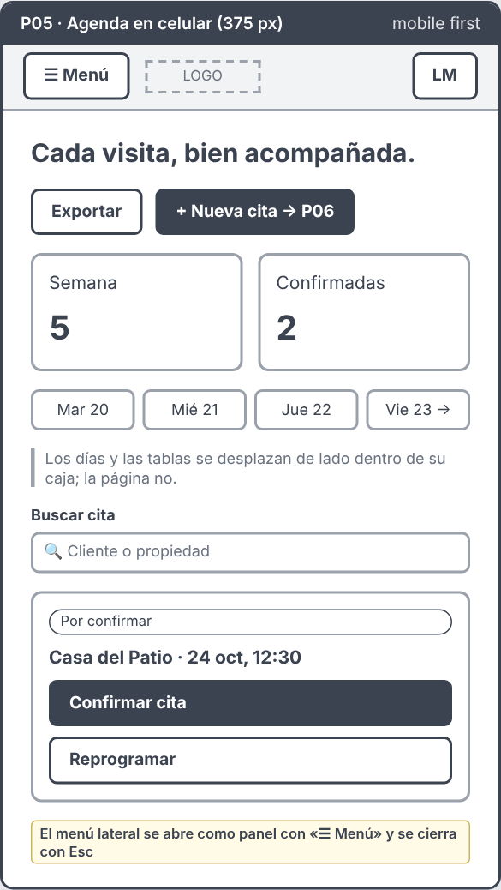

### Mapa de navegación

Muestra desde qué pantalla se llega a cada interfaz (flecha continua) y cómo se regresa (flecha punteada). Además, desde cualquier pantalla del panel, el menú lateral lleva a P02, P03, P05 y P08–P11, y las migas de pan («Administración / …») regresan a la sección anterior.

---

## Parte 3. Evidencia de interfaces maquetadas

| Aspecto | Evidencia en el proyecto |
|---|---|
| **Estructura React** | `src/admin/pages/` (una página por ruta), `src/admin/components/` (Shell, Overlay, ui.tsx), `src/data/` (datos ficticios, catálogo e inventario de pantallas), `src/admin/servicio.ts` (servicio de datos simulado) y `src/admin/main.tsx` con las rutas de React Router |
| **HTML y JSX** | `<header>`, `<nav>`, `<main>`, `<aside>`, `<footer>`, `<section aria-labelledby>`, tablas con `<th>`, formularios con `label htmlFor` + `id` y botones con texto específico («Agendar cita», «Sí, cancelar cita», «Guardar nuevo horario») |
| **Componentes** | `Shell` (encabezado y menú), `Crumbs`, `PageHead`, `Metric`, `Tabs` accesibles, `Badge`/`ApptBadge`/`StatusBadge`, `Photo`, `Pager`, `FieldError`, diálogos y avisos (`Overlay`) con props tipadas en TypeScript |
| **Tailwind** | Tailwind 4 con `@tailwindcss/vite`. La paleta y la tipografía están en `@theme` (`bg-marino`, `text-texto-suave`, `border-borde`…). Los componentes repetidos están en `@layer components` y las utilidades se usan en el JSX (menú móvil, esqueleto de carga) |
| **Responsividad** | Enfoque *mobile first*: las reglas base son para 375 px y se agregan columnas con `min-width` en los mismos cortes de Tailwind (`sm` 640, `md` 768, `lg` 1024, `xl` 1280). Probado en 375, 768 y 1280 px sin desbordamiento horizontal |
| **Dinamismo** | Estado local con datos ficticios (`src/data/`), **sin API ni servidor**: filtros, búsqueda, pestañas, nueva cita, confirmar, reprogramar, realizada, cancelar, alta y edición de propiedades, solicitudes (agendar, proponer casas, mensajes), contrato y pagarés (registrar, corregir y anular pagos), expediente (subir y ver documentos) y exportar CSV. Lo que se envía en los formularios del sitio público se guarda con `localStorage` y aparece en P10 |
| **Estados de interfaz** | Carga simulada (esqueleto y «Cargando datos de Zugar…»), vacío («Ninguna … coincide»), error (validación por campo y en el login), éxito (aviso flotante) y confirmación (diálogos) |
| **Accesibilidad** | Foco visible (anillo azul), enlace «Saltar al contenido», menú y pestañas operables con teclado (Esc cierra menús y diálogos), `aria-current`, `aria-expanded`, `aria-invalid` + `aria-describedby`, y `aria-live` en avisos, contadores de filtros y panel de la cita |

### Capturas del prototipo (375 · 768 · 1280 px)

| | 375 px (celular) | 768 px (tableta) | 1280 px (computadora) |
|---|---|---|---|
| P02 Resumen |  | 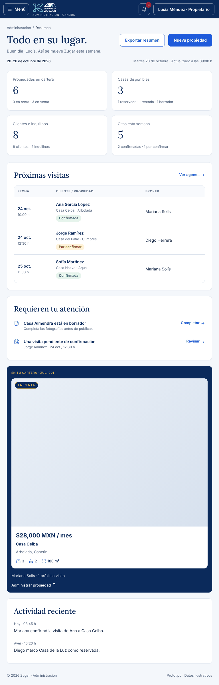 | 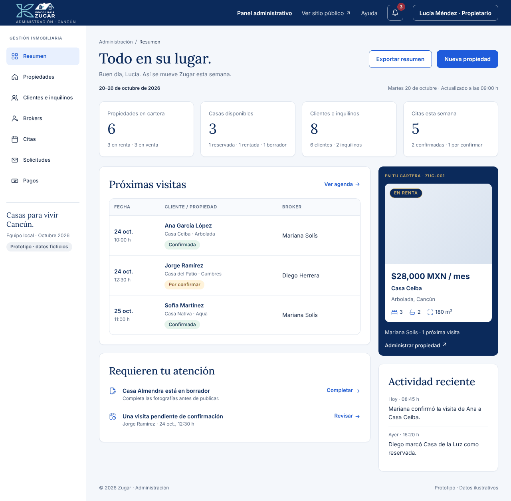 |
| P05 Citas |  |  |  |
| P03 Propiedades | 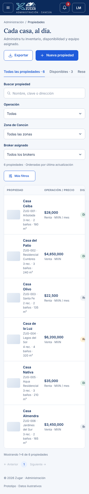 |  | 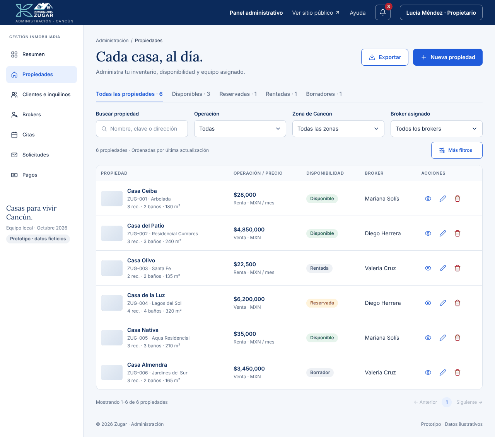 |
| P10 Solicitudes |  | 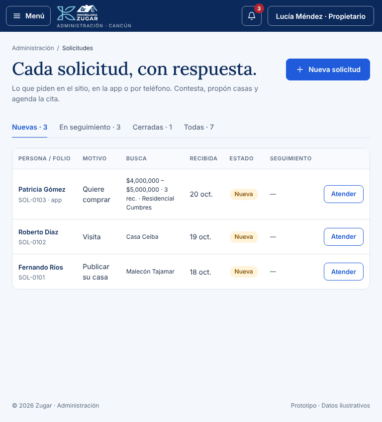 | 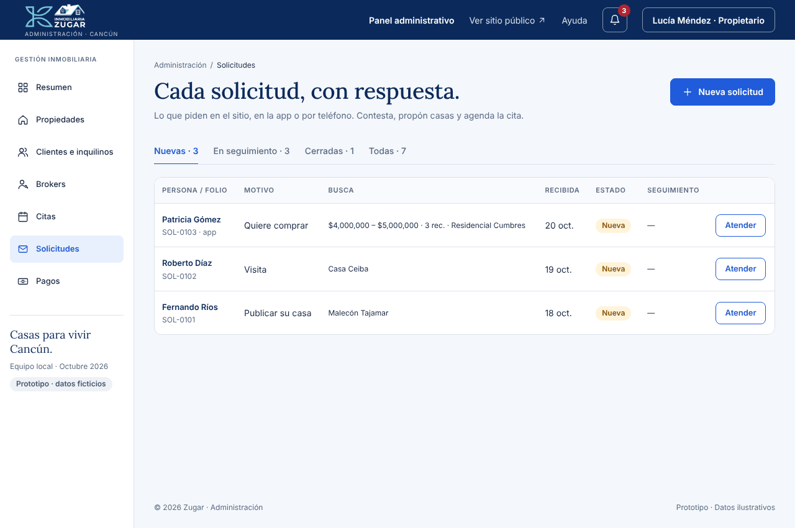 |
| P11 Pagos | 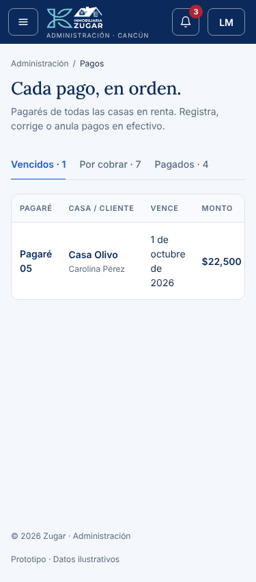 |  | 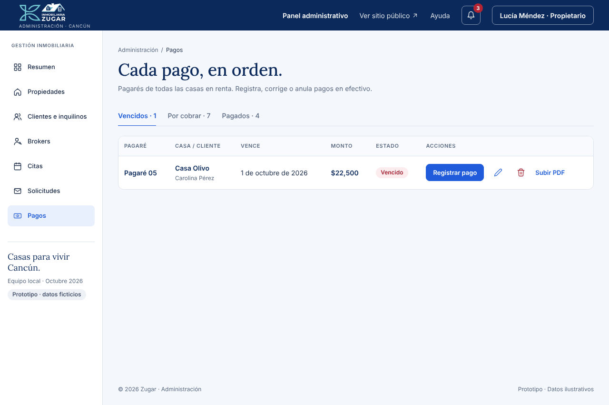 |
| Sitio público |  | 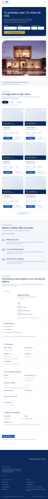 | 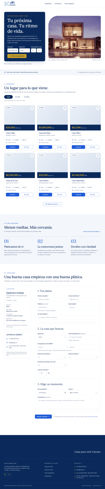 |

| Menú en celular | Carga simulada | Error de validación (P06) | Error en el login (P01) |
|---|---|---|---|
| 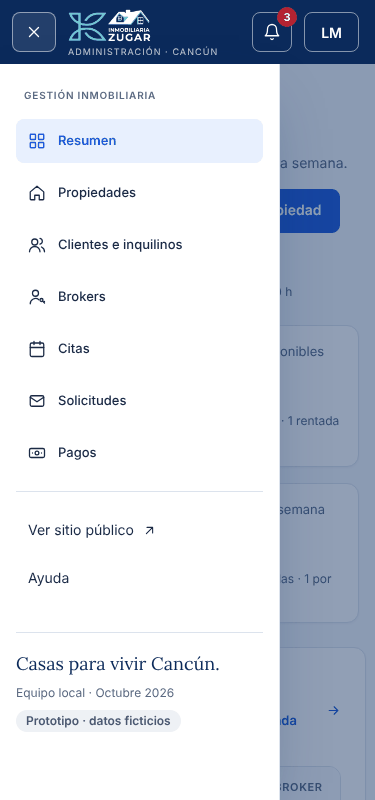 | 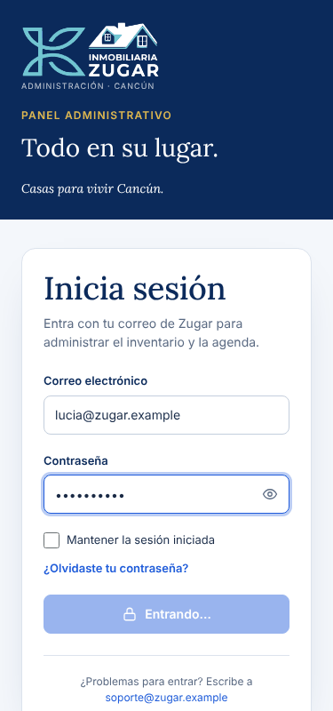 | 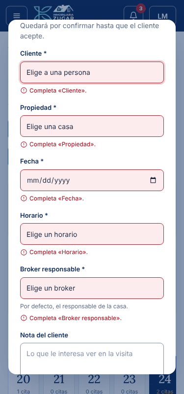 | 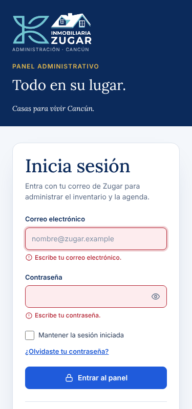 |

### Pruebas y correcciones

| Prueba | Resultado inicial | Corrección |
|---|---|---|
| Ancho de 375 px y 768 px en todas las pantallas del panel | La página medía 960 px de ancho (`body { min-width: 960px }`) y había desbordamiento horizontal | Se quitó el ancho mínimo y el CSS se reescribió en *mobile first* con `min-width` |
| Menú lateral en celular | Ocupaba 216 px fijos y no cabía el contenido | Botón «☰ Menú» (`lg:hidden`) que abre un panel deslizable; se cierra con Esc, con el fondo o al navegar |
| Encabezado en celular | El nombre «Lucía Méndez · Administradora» no cabía | En celular se muestran las iniciales y el nombre queda para lectores de pantalla; «Ver sitio» y «Ayuda» pasan al menú |
| Rejillas (métricas, filtros, formularios, galería) | 4–5 columnas fijas | 1–2 columnas en celular, 3–4 en escritorio |
| Pestañas, tabla y días de la semana | Se salían de la pantalla | Se desplazan de lado dentro de su propia caja |
| Paneles «pegajosos» (`sticky`) en celular | Tapaban el contenido | Solo se aplican desde `lg` |
| Estado de carga | Sin servidor no había ningún estado de carga | Carga simulada de 0.7 s con esqueleto y `role="status"` |
| Prototipo sin backend | El panel y el sitio intentaban conectarse a una API (puerto 3000), a Firebase y a Nominatim; Solicitudes y Pagos solo mostraban un aviso | Se quitó toda conexión. `src/admin/servicio.ts` simula las respuestas con datos de `src/data/` y una pequeña espera; Solicitudes, Pagos, Expediente y la campana ya funcionan |
| Botón «Usar la app» del sitio | Abría un aviso con QR y «Abrir aquí en la computadora» hacia una app que no existe en el prototipo | Se quitaron el aviso y los botones; en su lugar hay «Ver casa», «Ver más casas» y «Contáctanos» |
| Ancho de 375 px en Solicitudes | Un texto oculto para lectores de pantalla («Acciones») ensanchaba la página a 598 px | `.table-wrap { position: relative }`: ese texto queda dentro de la tabla con desplazamiento |
| Ancho de 768 px en Citas | Los tres botones del encabezado no cabían | Los botones bajan de renglón (`flex-wrap`) y se alinean a la derecha |
| Sitio público y panel en 375, 768, 1024 y 1280 px | — | 16 pantallas (6 del sitio y 10 del panel) revisadas en los 4 tamaños, sin desbordamiento horizontal |
| Flujo completo con teclado y ratón (375 px) | — | Nueva cita sin datos → errores por campo; choque de horario detectado; cita creada → confirmada → realizada con aviso `aria-live` |
| Consola del navegador | — | Sin errores de JavaScript; solo fallan las fotos que el equipo aún no sube (se muestra un recuadro gris) |

---

## Parte 4. Repositorio de GitHub

- Enlace: `https://github.com/USUARIO/REPOSITORIO` _(reemplazar)_. Si el repositorio es privado, hay que agregar al docente como colaborador.
- El README contiene: nombre del proyecto y equipo, problema, flujo, lista de interfaces, mapa, capturas de bocetos y del prototipo, tecnologías, estructura e instrucciones.
- Verificación en una carpeta nueva: `git clone …`, `npm install` y `npm run dev`. Abrir `http://localhost:5500/admin/` y entrar con `lucia@zugar.example` / `Zugar2026!`.

---

## Preparado para el backend (Unidad 3)

El prototipo **no se conecta a ninguna API**: todo funciona con JavaScript y datos ficticios. Aun así, está listo para el backend. Todas las pantallas piden sus datos a un solo archivo, `src/admin/servicio.ts`, con funciones como `Requests.list()`, `Requests.schedule()`, `Finance.notes()` o `Finance.registerPayment()`. Hoy esas funciones responden desde `src/data/demo.ts` tras una espera simulada (`setTimeout`). En la Unidad 3 solo hay que cambiar el interior de esas funciones por llamadas `fetch` al servidor; las pantallas, los tipos (`Lead`, `Note`, `Appointment`…) y los estados de carga y error ya están hechos.
